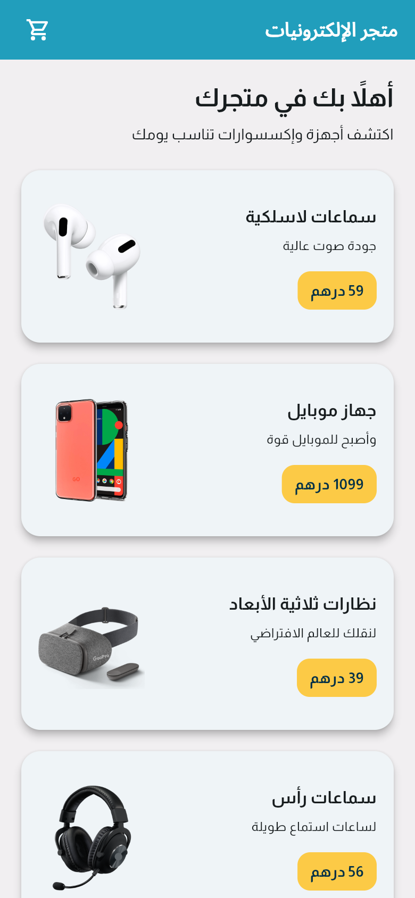
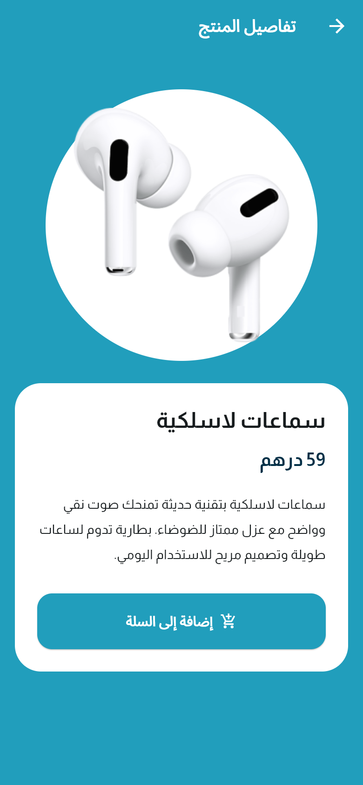
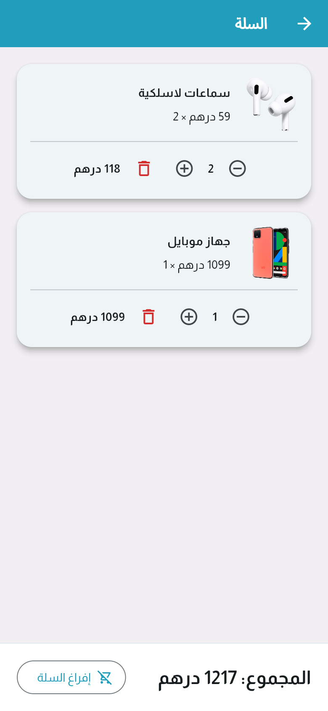
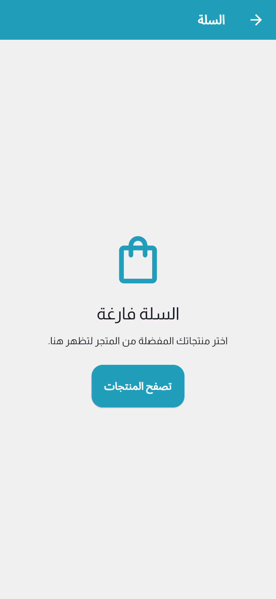
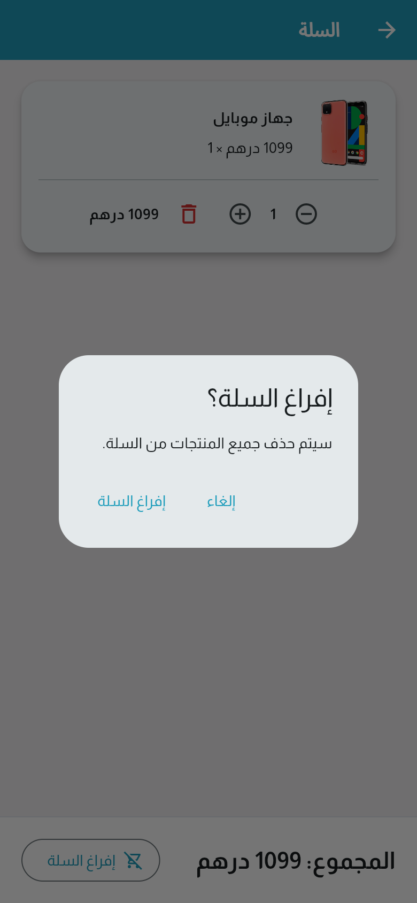
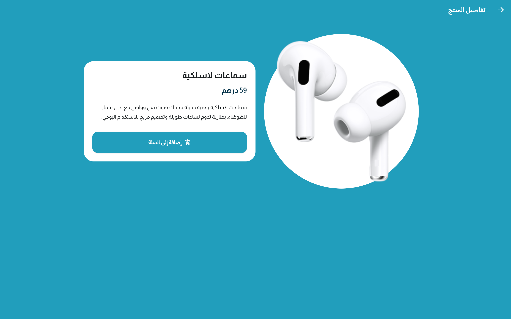
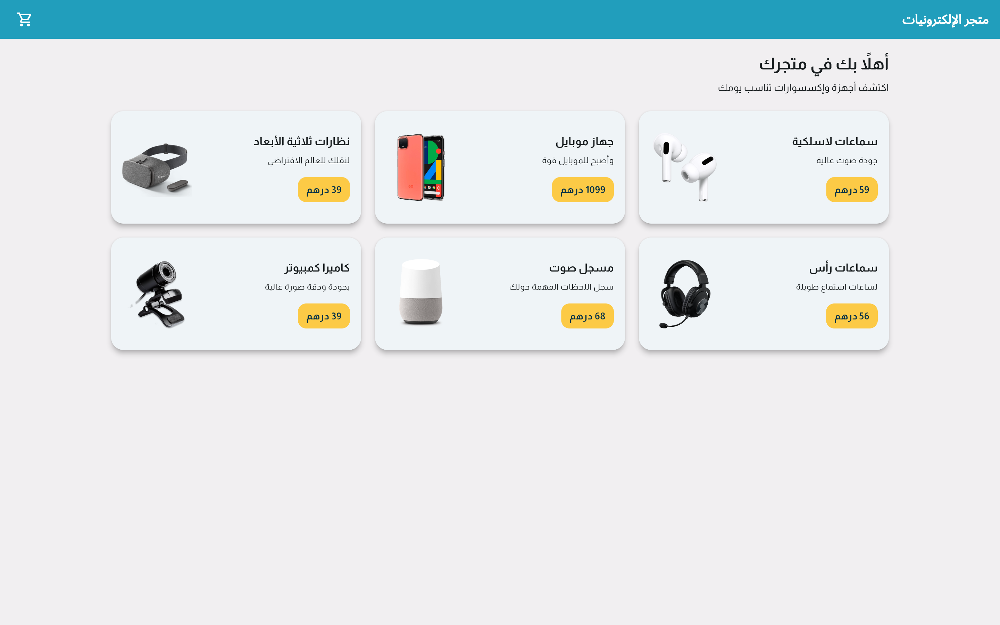

# Electronics Store · متجر الإلكترونيات

A responsive Arabic electronics storefront built with Flutter. Browse a six-product catalog, inspect product details, and manage an in-memory shopping cart with quantity controls and consistent dirham pricing.

تطبيق متجر إلكترونيات عربي يدعم اتجاه RTL، مع صفحات للمنتجات والتفاصيل والسلة وتصميم متجاوب للموبايل والويب.

## Features

- Arabic interface, RTL navigation, and a bundled Almarai font.
- Responsive catalog: a single column on phones, two on medium screens, and three on wide screens.
- Product images, descriptions, prices, and animated transitions into details.
- Cart badge showing the total number of units.
- Increase/decrease quantity, remove an entire product line, and accurate totals.
- Clear-cart confirmation and an empty-cart state with a return-to-shopping action.
- Accessible icon labels, responsive controls, and local product assets.

This is a storefront demonstration, not a connected commerce backend. There is no authentication, database, payment processing, checkout, or order fulfillment. Cart state is intentionally in memory and resets when the application restarts or the browser refreshes.

## Screenshots

Captured from the actual Flutter web release build in Chrome. Mobile previews use a 390 × 844 viewport; desktop previews use 1440 × 900. All products are the repository's bundled demo data; no real customer information is used.

| Mobile catalog | Product details |
| --- | --- |
|  |  |

| Shopping cart | Empty cart |
| --- | --- |
|  |  |

| Clear confirmation | Desktop details |
| --- | --- |
|  |  |



## Technology

- Flutter and Dart, Material 3.
- Provider / ChangeNotifier for cart state.
- Flutter localizations for Arabic widgets and navigation.
- Almarai Regular/Bold bundled locally, with its SIL Open Font License.
- Flutter test and flutter_lints for regression checks.

The app no longer uses the google_fonts package to download Almarai at runtime. Product images and Almarai ship with the app. Web renderer resources can also be served locally using the build command below. Flutter web may still request engine fallback fonts from fonts.gstatic.com; the web build is not claimed to be fully offline.

## Requirements

- Flutter **3.38 or newer**, Dart **3.10 or newer**.
- Chrome for web development.
- For Android: Android Studio/SDK and accepted Android SDK licenses.
- iOS/macOS builds require macOS and Xcode. Windows desktop builds require Visual Studio's Desktop development with C++ components.

Validated using Flutter 3.38.9 and Dart 3.10.8. These are tested versions, not a claim about the latest SDK release.

## Get started

```sh
git clone https://github.com/obadaburini/store_app.git
cd store_app
flutter pub get
flutter run -d chrome
```

No `.env`, API key, backend server, or database setup is required.

For Android, connect a device or start an emulator, then run:

```sh
flutter doctor
flutter doctor --android-licenses
flutter devices
flutter run -d <device-id>
```

Review and accept licenses yourself. The included Android application ID and debug release-signing configuration are template defaults; configure your own application ID and private release signing before store distribution. Never commit signing keys or key.properties.

## Build

```sh
flutter build web --release --no-web-resources-cdn
```

Deploy the contents of `build/web/` to a static web host. Serve the files over HTTP/HTTPS instead of opening index.html with a file URL. For a deployment below a subdirectory, pass the appropriate `--base-href` value. A local preview can use `flutter run -d chrome --release`.

Platform builds, once the required toolchains are configured:

```sh
flutter build apk --release
flutter build windows --release
```

Native release artifacts were not generated as part of the web screenshot audit. Android license acceptance and Windows C++ build components are still required on the audit machine.

## Tests and code quality

```sh
flutter analyze
flutter test
dart format --output=none --set-exit-if-changed lib test
```

Regression tests cover quantity aggregation, totals, removing a line with more than two units, decrementing to zero, clearing, immutable exposed cart state, RTL navigation, the full add/remove shopping flow, and small/large layouts. See [the audit](docs/AUDIT.md) for validation details.

## Project structure

```text
lib/
  main.dart                 App, Arabic locale, and Material theme
  constants.dart            Brand colors and shared currency formatting
  models/product.dart       Immutable demo product catalog
  screens/                  Catalog and product details screens
  widgets/                  Responsive cards and reusable product image
  cart/                     Cart state, quantity controls, and empty state
images/                     Bundled product images
assets/fonts/               Almarai fonts and license
test/                       Cart and widget regression tests
docs/screenshots/           Reviewed documentation screenshots
```

## Repository hygiene

Flutter build outputs, Dart/Pub caches, ephemeral platform directories, local configuration, and signing credentials are ignored. `pubspec.lock` is committed for reproducible application dependencies. Flutter's tracked platform runners and plugin-registration source files are retained; they are part of the platform scaffolding, not binary build output.

## Font attribution

Almarai is copyright the Almarai Project Authors and distributed under the SIL Open Font License 1.1. The complete license is included at [assets/fonts/OFL.txt](assets/fonts/OFL.txt). Fonts were obtained from the official Google Fonts repository.
